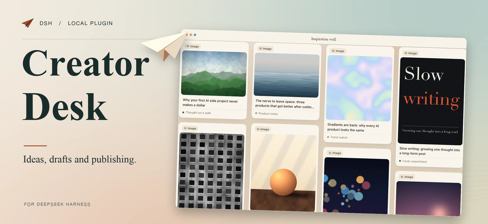
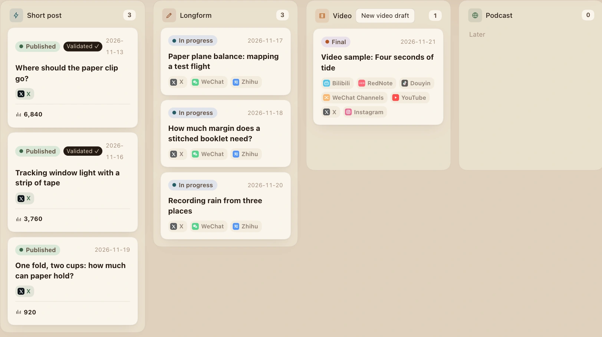
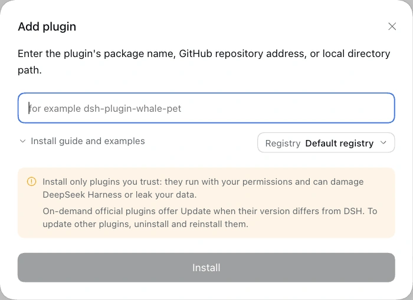
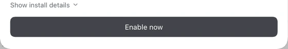
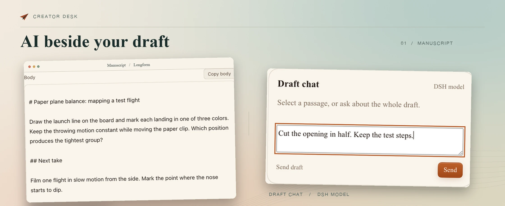
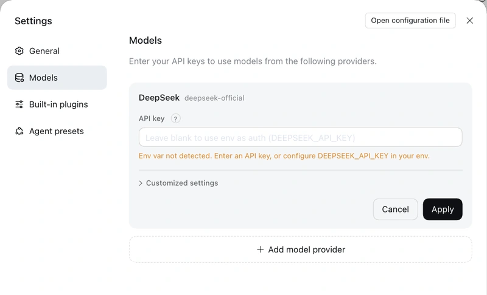
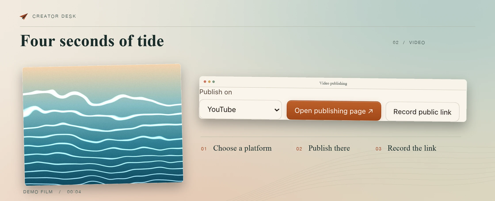
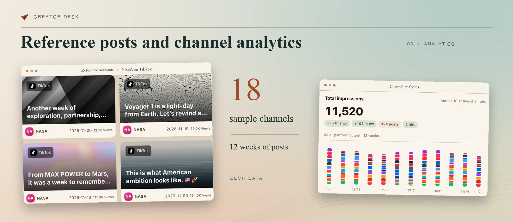

[简体中文](README.md) · **English**

<picture>
  <source media="(prefers-color-scheme: dark)" srcset="docs/showcase/en/cover-night.webp">
  
</picture>

**DSH Creator Desk** is a local plugin for [DeepSeek Harness](https://www.deepseek.com/download/) (DSH). Collect ideas, ask AI to edit a passage beside your draft, and prepare articles or videos for publication. Your manuscript files stay on your computer. You choose when to send text to a model or publish on a platform.

**[Download the desktop plugin · v2.7.2 (ZIP)](https://raw.githubusercontent.com/ozrwayne/dsh-creator-desk/main/downloads/dsh-media-desk-desktop-2.7.2.zip)** · [Install](#desktop-installation) · [Try the video](#video-publishing) · [Explore the sample channels](#reference-accounts-and-channel-analytics)

<details>
<summary>View the content board</summary>



</details>

## Desktop installation

1. Install [DeepSeek Harness Desktop](https://www.deepseek.com/download/) and unzip the **desktop plugin** linked above. Keep the folder containing `package.json` and `dist/client.js` somewhere permanent. You can install this package without a terminal. If you used GitHub's **Code → Download ZIP**, follow [the source instructions](#installation-from-source).
2. In the DSH sidebar, select **Plugins → Add plugin**. Paste the full local path to the extracted folder on your computer, click **Install**, and keep that folder in place after installation.



3. On the **Installed** screen, click **Enable now**, then open **Media Desk** in the sidebar. A fresh default workspace populates **Content** with three short posts, three longform drafts, and one video. The plugin never writes sample files into an existing workspace or a custom directory.

Click **中/EN** to switch the interface language to English. While the sample manuscripts shown in the guide screenshots were translated for demonstration, switching the interface language leaves your own files and the original titles of reference posts unchanged.

<details>
<summary>Find the activation button</summary>



</details>

## AI beside your draft

<picture>
  <source media="(prefers-color-scheme: dark)" srcset="docs/showcase/en/manuscript-night.webp">
  
</picture>

Open **Content**, select a draft, and type your request in **Draft chat**. Highlight a passage to ask about that passage; leave the selection empty to ask about the whole draft. Click **Apply to draft** to accept a suggestion or **Undo edit** to take it back. **Save body** writes your changes to disk. [View the editor](docs/guide/en/draft-chat.webp)

<details>
<summary>Choose a model in DSH for the first time</summary>

In DSH, open **Account menu → Settings → Models**. Enter your DeepSeek API key, or click **Add model provider** for another service. In a DSH session, select a model below the message box, then return to your manuscript. The same session works across drafts; there is no second model picker in Creator Desk.



When you click **Send** in draft chat, the selected model receives your request, the draft title, the selected passage or full draft body, and up to six recent turns from that draft chat. If you select a cloud model, those contents go to your provider.

Browsing the bundled samples requires no API key and triggers no model calls. The desktop plugin runs without connecting to the author's network, though using a cloud model requires an internet connection from your computer to your chosen provider. [DSH model configuration](https://deepseek-harness.github.io/deepseek-harness/guide/providers)

</details>

## Video publishing

<picture>
  <source media="(prefers-color-scheme: dark)" srcset="docs/showcase/en/publish-night.webp">
  
</picture>

1. Open **Content → Video** and select the sample with the wave thumbnail. Play the four-second clip. Expand **Multi-platform materials and copy** to download the cover and finished video.
2. Choose a platform and click **Open publishing page**. Upload the video, preview it, and confirm publication on the platform.
3. Return to the draft, click **Record public link**, and paste the live URL. [View the video panel](docs/guide/en/video-publish.webp)

## Reference accounts and channel analytics

<picture>
  <source media="(prefers-color-scheme: dark)" srcset="docs/showcase/en/channels-night.webp">
  
</picture>

Before writing, open **Reference accounts** to filter posts by platform, account, or date, and click any card to visit the original post. The bundled snapshot includes 125 public entries from 20 platform accounts. [View sample reference posts](docs/guide/en/benchmark-accounts.webp)

After publishing, open **Insights** to track where a piece appeared, recorded impressions, and weekly publishing frequency across 12 weeks. The 18 channels belong to two fictional brands and display sample metrics. [View the publishing chart](docs/guide/en/channel-review.webp)

## Other workflows

- **Knowledge notes:** Place a Markdown file in `知识原子/待确认` (pending review) to edit and review it under **Knowledge atoms**. Approving a note moves the file into the approved folder so you can cite it inside longform drafts; rejecting a note moves it to `.trash/自媒体工作台/` in the demo vault rather than deleting it.
- **Longform publishing:** Copy the draft body into your target platform's editor, or preview and copy the formatted layout for WeChat. When connected to a paired browser, you can also send drafts to supported platform draft folders. Review and confirm publication manually on the platform, then record the live URL in Creator Desk.
- **Publishing walkthrough:** From the source directory, run `MEDIA_DESK_HOME="$PWD/.demo-publishing" npm run demo:init -- --publishing` to create two short post → article → video chains. The destination must not already exist. Start DSH with that same `MEDIA_DESK_HOME` and a separate `DSH_HOME`. The sample links use `https://example.org/`.
- **Offline use:** You can prepare drafts, organize video assets, export ZIP bundles, and record publication links offline. Signing in to real accounts, sending drafts to platforms, and confirming publication require separate online actions.

## Installation from source

Run `npm ci` and `npm run build` in the source directory, then add that directory to DSH using the desktop installation steps above. Maintainers can run `npm pack` to generate an installable package containing the built frontend and sample assets.

### Isolated web demo

Running the isolated web demo requires Node.js 20+, npm, and a compatible DSH web profile. Installing dependencies for the first time may require internet access. Run the following commands from the repository directory:

```sh
npm ci
export MEDIA_DESK_HOME="$PWD/.demo"
export DSH_HOME="$PWD/.dsh-demo"
unset MEDIA_DESK_INTEGRATIONS DSH_WEB_URL DSH_PROFILE DSH_PROFILE_DIR DSH_SESSION_ID
npm run demo:init
npm pack --pack-destination "${TMPDIR:-/tmp}"
dsh plugin --profile web add "${TMPDIR:-/tmp}/dsh-media-desk-2.7.2.tgz"
dsh --profile web --no-open --host 127.0.0.1 --port 4321
```

Open `http://127.0.0.1:4321` on the computer running DSH. The web demo has its own model settings and sign-in state, separate from the desktop app. `demo:init` refuses to overwrite an existing directory. Next time, keep `MEDIA_DESK_HOME` and `DSH_HOME` set and start DSH without running the initializer.

Background collection and publishing integrations are off by default. Set `MEDIA_DESK_INTEGRATIONS=1` to enable them. Draft chat does not need that setting; it uses the model configured in this DSH profile when you click **Send**. External automation skills do not ship with the plugin.

## Storage and rollback

State and workspace files reside in `$MEDIA_DESK_HOME/media-desk/`. When `MEDIA_DESK_HOME` is unset, the plugin defaults to `$DSH_HOME/media-desk-public/`, keeping data separate from your regular DSH workspace.

Inside `workspace/知识库/`, saved items, pending notes, approved notes, works in progress, final manuscripts, and published pieces each live in dedicated folders; a manuscript's folder location determines its workflow status. Exported publishing bundles are stored in `workspace/exports/发布包/`, while media files remain in an assets folder matching the manuscript name.

To reset the web demo, stop DSH, rename `.demo` as a backup, and run `npm run demo:init`. To roll back, stop DSH, move the new directory aside, and restore the backup folder's original name. Prebuilt public releases are stored in `downloads/`, while your own workspace files and credentials stay on your local machine.

## Build and verification

Run `npm test` to execute local tests in isolated directories, `npm run build` to compile the frontend and browser extension ZIP, and `npm pack` to create the DSH plugin package. Two fictional brand icons and generated media ship with the source repository; no third-party creator's article body or video is redistributed.

## Acknowledgments

We thank [@woniuniuniu](https://github.com/woniuniuniu), creator of [dsh-media-desk](https://github.com/woniuniuniu/dsh-media-desk), whose idea wall, content board, calendar, and analytics formed the foundation for this workbench. Their illustrated README also shaped how we present cover and feature visuals in this guide.

We used or consulted **9 projects**: five sources of code or API documentation, three host or service integrations, and one layout reference cited by the upstream README. We count a fork and its original as one project and exclude general build dependencies.

The **23 accounts** credited below represent 10 project authors or teams, seven upstream contributors, and six creators or organizations featured in the demo.

| Author or team | What we used |
| --- | --- |
| [@woniuniuniu](https://github.com/woniuniuniu) | [dsh-media-desk](https://github.com/woniuniuniu/dsh-media-desk) provides the upstream codebase for Creator Desk. |
| 麦当 [@CzzzzzzJ](https://github.com/CzzzzzzJ) | [mdldm-maitian](https://github.com/CzzzzzzJ/mdldm-maitian) documents post and follower metric collection; [mdldm-maitian-publisher](https://github.com/CzzzzzzJ/mdldm-maitian-publisher) supplies the bundled video form filler and publishing checks. |
| [@jackwener](https://github.com/jackwener) | [OpenCLI](https://github.com/jackwener/OpenCLI) provides reference implementations for WeChat Channels account identity and RedNote profile fields. |
| [@SocialSisterYi](https://github.com/SocialSisterYi) and [@nbt0](https://github.com/nbt0) | [bilibili-API-collect](https://github.com/SocialSisterYi/bilibili-API-collect) and the [documentation in @nbt0’s fork](https://github.com/nbt0/bilibili-api-collect/blob/master/docs/login/login_info.md) specify the Bilibili login identity fields referenced in our code. |
| [@deepseek-ai](https://github.com/deepseek-ai) | [DeepSeek Harness](https://github.com/deepseek-ai/deepseek-harness) hosts the plugin and supplies the model interface used by draft chat. |
| fun [@lljxx1](https://github.com/lljxx1) and [@wechatsync](https://github.com/wechatsync) | [Wechatsync](https://github.com/wechatsync/Wechatsync) enables sending longform articles to platform draft folders when installed separately by the user. |
| [@monid-ai](https://github.com/monid-ai) | [Monid](https://github.com/monid-ai/monid) provides cross-platform public data access used to collect selected posts and counts in the demo snapshot. |
| [@ccch1mneyyy](https://github.com/ccch1mneyyy) | [dsh-Go](https://github.com/ccch1mneyyy/dsh-Go) is credited in the original workbench README as the layout reference for its illustrated guide. |

<details>
<summary>Seven contributors thanked in the original workbench</summary>

The [upstream version we built on](https://github.com/woniuniuniu/dsh-media-desk/blob/fc237f3388d048f51c3145cfd411dbb80ba2b388/README.md#特别感谢) credits seven contributors for bug reports, investigations, and fixes:

- [@secountAiAccount](https://github.com/secountAiAccount): Identified dark-mode readability issues
- [@isxiaokunos](https://github.com/isxiaokunos): Diagnosed broken image-generation URLs
- [@townmi](https://github.com/townmi): Traced a missing model gateway session header
- [@zach22-1999](https://github.com/zach22-1999): Fixed X media imports
- [@chenxupeng1990-eng](https://github.com/chenxupeng1990-eng): Added model selection to the upstream assistant
- [@dsh-agent-sixtyseven](https://github.com/dsh-agent-sixtyseven): Fixed Monid invocation on Windows
- [@smallflycar](https://github.com/smallflycar): Enabled image generation with a GPT subscription

</details>

The [public snapshot](demo/bench-snapshot.json) contains 125 entries from 20 platform accounts belonging to **six creators or organizations**: Lindsay Zou [@xiao_lin_shuo](https://www.youtube.com/@xiao_lin_shuo), [@NASA](https://x.com/NASA), Noah Smith [@noahpinion](https://substack.com/@noahpinion), Simon Willison [@simonw](https://github.com/simonw), NPR’s Planet Money [@planetmoney](https://www.instagram.com/planetmoney/), and Xinhua News Agency [@XHNews](https://x.com/XHNews). Simon Willison's [Datasette](https://github.com/simonw/datasette), [LLM](https://github.com/simonw/llm), [sqlite-utils](https://github.com/simonw/sqlite-utils), [beep-locator](https://github.com/simonw/beep-locator), and [tools](https://github.com/simonw/tools) appear solely as sample GitHub cards and are excluded from the nine projects above.

## Sources and licenses

- The workbench retains the original author's [MIT copyright and license notice](LICENSE), the metrics adapter retains its [upstream MIT notice](src/monitor-browser.js), and the bundled video form filler is licensed under [Apache-2.0](extensions/maitian-publisher/LICENSE).
- Reference entries preserve public titles, original post links, and engagement counts returned at collection time. Platforms measure engagement differently. We leave missing counts blank and supply our own cover art for reference cards.
- The portrait of Lindsay Zou (小Lin说) is cropped, resized, and converted to JPEG from [Wikimedia Commons](https://commons.wikimedia.org/wiki/File:Lindsay_Zou.png), created by 小Lin说 under [CC BY 3.0](https://creativecommons.org/licenses/by/3.0/). Inclusion of public accounts or portraits implies no partnership or endorsement.
