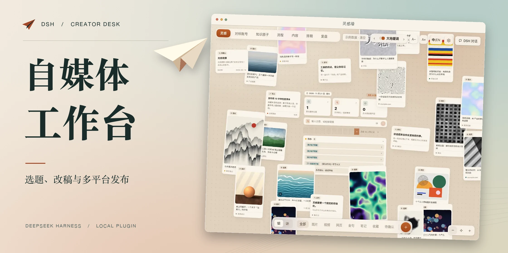
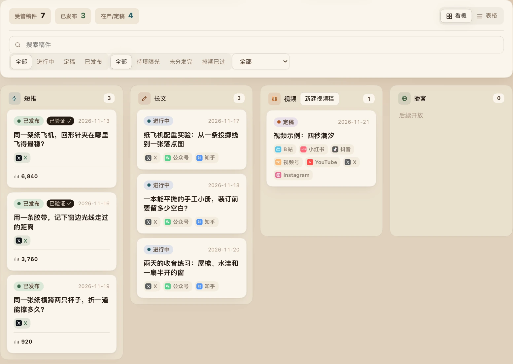
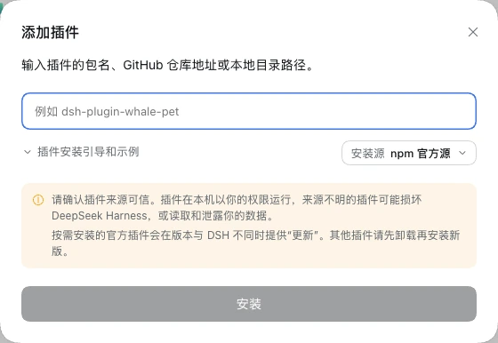
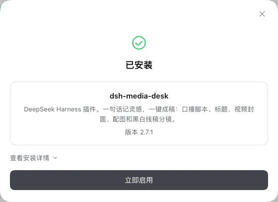
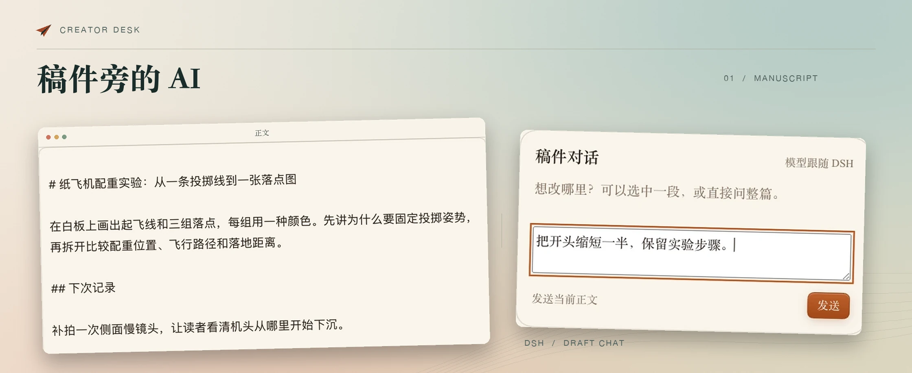
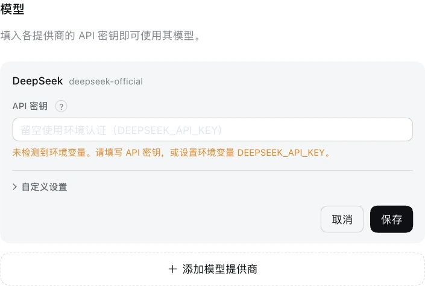
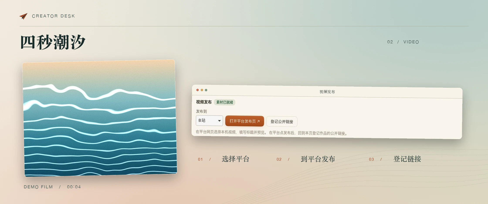

**简体中文** · [English](README.en.md)

<picture>
  <source media="(prefers-color-scheme: dark)" srcset="docs/showcase/cover-night.webp">
  
</picture>

**DSH 自媒体工作台**是 [DeepSeek Harness](https://www.deepseek.com/download/)（DSH）的本地插件。你可以在灵感墙上记选题，在稿件旁请 AI 改稿，再带着封面、正文或成片到平台发布。稿件保存在自己的电脑上

**[下载桌面插件 2.7.2（ZIP）](https://raw.githubusercontent.com/ozrwayne/dsh-creator-desk/main/downloads/dsh-media-desk-desktop-2.7.2.zip)** · [安装步骤](#桌面端安装) · [视频发布示例](#视频发布示例) · [对标账号与渠道复盘](#对标账号与渠道复盘)

<details>
<summary>查看内容看板原图</summary>



</details>

## 桌面端安装

1. 安装 [DeepSeek Harness 桌面端](https://www.deepseek.com/download/)，下载并解压上方的**桌面插件 ZIP**。把含 `package.json` 和 `dist/client.js` 的文件夹放到准备长期保留的位置。桌面安装不用命令行；GitHub 的 **Code → Download ZIP** 下载的是源码
2. 在 DSH 左侧栏点 **插件 → 添加插件**，粘贴这个文件夹在本机的完整路径，点 **安装**。安装后保留该文件夹



3. 点 **立即启用**，再从左侧栏打开 **自媒体工作台 → 内容**。首次使用默认目录时，里面有 3 条短推、3 篇长文和 1 个视频。已有目录和自定义目录都不会补写样稿

<details>
<summary>查看「立即启用」的位置</summary>



</details>

## 稿件旁的 AI

<picture>
  <source media="(prefers-color-scheme: dark)" srcset="docs/showcase/manuscript-night.webp">
  
</picture>

打开 **内容 → 任意稿件**，在正文旁的聊天框里输入修改要求。要改一段，先选中那段文字；不选则针对整篇。你可以采用或撤回建议，点 **保存正文** 才会写入文件。[查看编辑器原图](assets/guide/draft-chat.webp)

<details>
<summary>第一次在 DSH 配置模型</summary>

在 DSH 的 **账号菜单 → 设置 → 模型** 配置服务。使用 DeepSeek 就填自己的 API Key；使用其他服务就点 **添加模型提供商**。回到 DSH 会话，在输入框下方选好模型，再回稿件。换稿不用新开会话



在稿件聊天框点 **发送** 时，工作台会把修改要求、稿件标题、所选段落或整篇正文，以及本稿最近最多六轮对话发给所选模型。使用云模型时，这些内容会发给你配置的服务商

浏览样稿无需密钥，也不会调用模型。在自己的电脑上安装、使用插件，不用连接作者的局域网；调用云模型时需要能访问服务商。[DSH 官方配置说明](https://deepseek-harness.github.io/deepseek-harness/guide/providers)

</details>

## 视频发布示例

<picture>
  <source media="(prefers-color-scheme: dark)" srcset="docs/showcase/publish-night.webp">
  
</picture>

1. 打开 **内容 → 视频 → 视频示例：四秒潮汐**，播放样片。展开 **多平台素材与文案** 可下载封面和成片
2. 选择目标平台，点 **打开平台发布页**，在平台上传视频、预览并确认发布
3. 回到这篇视频稿，点 **登记公开链接**，粘贴作品地址。[查看视频稿原图](assets/guide/video-publish.webp)

## 对标账号与渠道复盘

<picture>
  <source media="(prefers-color-scheme: dark)" srcset="docs/showcase/channels-night.webp">
  
</picture>

**选题时看对标。** 随包快照收录了 20 个平台账号的 125 条公开内容。按平台、账号或时间筛选，点卡片看原帖。[查看 B 站对标原图](assets/guide/benchmark-accounts.webp)

**发布后看复盘。** 两个虚构品牌的 18 个渠道演示了三件事：一条选题发过哪些平台、记录了多少曝光、最近 12 周发得有多频繁。[查看复盘原图](assets/guide/channel-review.webp)

## 体验路径

- **知识原子**：将自己的 Markdown 笔记放入「知识原子/待确认」目录，即可在工作台中编辑并审核。可用预置笔记「光线观察」体验确认操作，用「废弃草图」体验否决操作：确认后工作台会把该 Markdown 文件移入已确认目录，否决后文件保留在演示库的 `.trash/自媒体工作台/` 中。撰写长文时，点「参考 → 添加参考原子」即可手动引用已确认笔记
- **长文发布**：复制正文到目标平台的编辑器。发公众号时，可以先在「公众号排版」里预览再复制。连接浏览器后，也可以把文章送进所选平台的草稿箱。到平台确认发布，再回工作台登记公开链接
- **发布验收**：要试两条完整的「短推 → 长文 → 视频」内容线，在源码目录运行 `MEDIA_DESK_HOME="$PWD/.demo-publishing" npm run demo:init -- --publishing`。目标目录必须尚不存在。启动 DSH 时沿用同一 `MEDIA_DESK_HOME`，另设独立的 `DSH_HOME`。样例链接使用 `https://example.org/`
- **边界**：草稿准备、视频素材整理、ZIP 发布包导出与记录回填均可在本机离线验证；真实账号授权、发送草稿至平台以及在平台最终确认发布，需连接对应平台另行操作

## 从源码安装

从源码安装时，先在源码目录依次运行 `npm ci` 和 `npm run build` 生成构建产物，再按前文「桌面端安装」的步骤将该目录添加到 DSH。维护者如需打包分发，可运行 `npm pack` 生成包含前端产物与示例素材的发行包

### 独立 Web 演示环境

独立 Web 演示环境供你在本机浏览器中试用工作台，运行前需准备 Node.js 20+、npm 和兼容的 DSH Web profile。首次安装依赖时可能需要联网。在仓库目录运行：

```sh
npm ci
export MEDIA_DESK_HOME="$PWD/.demo"
export DSH_HOME="$PWD/.dsh-demo"
unset MEDIA_DESK_INTEGRATIONS DSH_WEB_URL DSH_PROFILE DSH_PROFILE_DIR DSH_SESSION_ID
npm run demo:init
npm pack --pack-destination "${TMPDIR:-/tmp}"
dsh plugin --profile web add "${TMPDIR:-/tmp}/dsh-media-desk-2.7.2.tgz"
dsh --profile web --no-open --host 127.0.0.1 --port 4321
```

在运行 DSH 的电脑上打开 `http://127.0.0.1:4321`。Web 演示使用独立目录，不复用桌面版的模型配置或登录状态。`demo:init` 拒绝覆盖已有目录。下次保留 `MEDIA_DESK_HOME` 和 `DSH_HOME`，直接启动 DSH 即可

后台采集和发布桥接默认关闭，可通过 `MEDIA_DESK_INTEGRATIONS=1` 开启。稿件聊天不需要这个开关，只在你点发送时调用当前 DSH 配置的文字模型。外部自动化技能不随仓库分发

## 存储与回退

插件在 `$MEDIA_DESK_HOME/media-desk/` 下保存运行状态与工作区；未指定 `MEDIA_DESK_HOME` 时，默认使用 `$DSH_HOME/media-desk-public/`，与常规工作台数据分开存放

工作区内，`workspace/知识库/` 下的收藏、待确认、已确认、进行中、定稿、已发布均为真实目录，稿件当前状态由其所在目录决定。导出的发布包保存在 `workspace/exports/发布包/`，媒体文件保留在对应稿件的同名素材目录中

如需重置演示环境，先停止演示进程，将现有 `.demo` 目录改名留作备份，再运行 `npm run demo:init` 创建新目录；如需回退，停止进程后移开新目录，并将备份目录改回原名

`downloads/` 目录内提供可直接安装的公开发行版本；你的工作区文件与本地凭证均保存在本机

## 验证

本地验证与打包可使用三条命令：`npm test` 在隔离目录中运行本地测试用例；`npm run build` 从源码构建前端与扩展 ZIP；`npm pack` 生成 DSH 安装包

公开发行包不附带创作者的文章正文或视频。两枚虚构账号图标与程序化示例素材随源码分发，常规安装无需重新绘制

## 致敬

感谢蜗牛的科技笔记 [@woniuniuniu](https://github.com/woniuniuniu)。本项目基于他的 [dsh-media-desk](https://github.com/woniuniuniu/dsh-media-desk) 继续开发，沿用了灵感墙、内容看板、排期与复盘的基础结构；这份 README 的封面和功能图也参考了原版的展示方式

我们使用或参考了 **9 个项目**：5 个提供代码或接口资料，3 个提供宿主或外部服务，1 个是上游 README 的排版参考。原项目与 fork 合算一个，通用构建依赖另计

以下 **23 个署名账号**分别来自项目作者与团队（10）、上游贡献者（7）和演示内容的创作者与机构（6）

| 作者／团队 | 项目与贡献 |
| --- | --- |
| [@woniuniuniu](https://github.com/woniuniuniu) | [dsh-media-desk](https://github.com/woniuniuniu/dsh-media-desk) 提供工作台的上游代码基础 |
| 麦当 [@CzzzzzzJ](https://github.com/CzzzzzzJ) | [麦田工作台](https://github.com/CzzzzzzJ/mdldm-maitian) 提供作品与粉丝指标的读取参考；[麦田发布助手](https://github.com/CzzzzzzJ/mdldm-maitian-publisher) 提供随包视频填表扩展及发布包校验来源 |
| [@jackwener](https://github.com/jackwener) | 借助 [OpenCLI](https://github.com/jackwener/OpenCLI) 的视频号与小红书适配器核对账号身份与资料字段 |
| [@SocialSisterYi](https://github.com/SocialSisterYi)、[@nbt0](https://github.com/nbt0) | 依据 [bilibili-API-collect 原项目](https://github.com/SocialSisterYi/bilibili-API-collect) 核对 B 站登录身份字段；代码实际引用 [@nbt0 分支上的文档](https://github.com/nbt0/bilibili-api-collect/blob/master/docs/login/login_info.md) |
| [@deepseek-ai](https://github.com/deepseek-ai) | [DeepSeek Harness](https://github.com/deepseek-ai/deepseek-harness) 提供插件宿主与稿件对话的模型调用入口 |
| fun [@lljxx1](https://github.com/lljxx1)、[@wechatsync](https://github.com/wechatsync) | 支持通过 [Wechatsync](https://github.com/wechatsync/Wechatsync) 将长文稿件送入平台草稿箱，该扩展需由用户另行安装 |
| [@monid-ai](https://github.com/monid-ai) | [Monid](https://github.com/monid-ai/monid) 提供跨平台公开数据接口，用于获取演示快照中的部分帖子与计数 |
| [@ccch1mneyyy](https://github.com/ccch1mneyyy) | [dsh-Go](https://github.com/ccch1mneyyy/dsh-Go) 为蜗牛在原版 README 中注明的图文排版参考 |

<details>
<summary>原版工作台特别感谢的 7 位贡献者</summary>

感谢本项目沿用的[上游版本](https://github.com/woniuniuniu/dsh-media-desk/blob/fc237f3388d048f51c3145cfd411dbb80ba2b388/README.md#特别感谢)中 7 位贡献者留下的问题记录与修复：

- [@secountAiAccount](https://github.com/secountAiAccount)：发现深色界面的可读性问题
- [@isxiaokunos](https://github.com/isxiaokunos)：排查生图地址错误
- [@townmi](https://github.com/townmi)：定位模型网关的会话头问题
- [@zach22-1999](https://github.com/zach22-1999)：修复 X 媒体导入
- [@chenxupeng1990-eng](https://github.com/chenxupeng1990-eng)：为上游助手增加模型选择
- [@dsh-agent-sixtyseven](https://github.com/dsh-agent-sixtyseven)：修复 Windows 上的 Monid 调用
- [@smallflycar](https://github.com/smallflycar)：接入 GPT 订阅生图

</details>

**演示快照的公开内容来源：** [公开快照](demo/bench-snapshot.json)收录的 20 个平台账号、125 条记录，去重后来自 **6 个公开创作者或机构**：小Lin说 [@xiao_lin_shuo](https://www.youtube.com/@xiao_lin_shuo)、[@NASA](https://x.com/NASA)、Noah Smith [@noahpinion](https://substack.com/@noahpinion)、Simon Willison [@simonw](https://github.com/simonw)、NPR 的 Planet Money [@planetmoney](https://www.instagram.com/planetmoney/)、新华社 [@XHNews](https://x.com/XHNews)。其中 Simon Willison 的 [Datasette](https://github.com/simonw/datasette)、[LLM](https://github.com/simonw/llm)、[sqlite-utils](https://github.com/simonw/sqlite-utils)、[beep-locator](https://github.com/simonw/beep-locator) 和 [tools](https://github.com/simonw/tools) 仅作为 GitHub 作品卡展示，未计入前文的 9 个项目

## 来源与许可

- 工作台本体保留原作者的 [MIT 版权与许可声明](LICENSE)；麦田指标适配保留[上游 MIT 声明](src/monitor-browser.js)；随包分发的视频填表扩展遵循 [Apache-2.0](extensions/maitian-publisher/LICENSE)
- 对标样例保留公开帖子的标题、原帖链接及采集时平台返回的计数。各平台指标统计口径不同，缺失值保持留空。作品卡片的题图由本项目绘制
- 小Lin说头像来自 [Wikimedia Commons](https://commons.wikimedia.org/wiki/File:Lindsay_Zou.png)（作者：小Lin说，采用 [CC BY 3.0](https://creativecommons.org/licenses/by/3.0/) 许可），展示版经裁切、缩放并转为 JPEG 格式。收录公开内容不代表合作或背书
